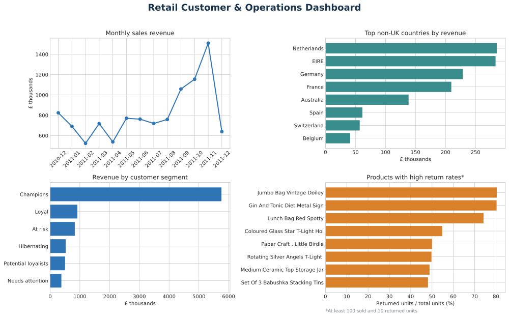

# Retail Customer & Operations Analytics

[](https://github.com/MUmairSarwar/retail-customer-analytics/actions/workflows/tests.yml)

A Python and SQL analysis of one year of transactions from a UK online retailer (UCI Online Retail, December 2010 to December 2011). It answers three practical questions: where revenue comes from, which customers are drifting away, and which products are cancelled or returned unusually often. The output is a set of KPI tables, a SQLite database with documented queries, a Streamlit dashboard and a short executive summary.



## Questions

1. How do sales and order value change over the year?
2. Which countries contribute most revenue outside the UK?
3. How concentrated is revenue among customers?
4. Which customers are loyal, at risk or inactive?
5. Which products have high return rates at a volume large enough to matter?

## Results

From 541,909 source rows, 530,104 are valid sales lines:

| Measure | Value |
|---|---:|
| Sales revenue (gross, see definitions) | £10.67 million |
| Orders | 19,960 |
| Average order value | £534 |
| Cancelled/returned value as share of sales plus returns | 7.8% |
| Identified customers | 4,338 |
| Customers with at least two orders | 65.6% |
| Revenue share of the top 10% of identified customers | 61.4% |
| "At risk" customers (see RFM below) | 663, with £830k of past sales |

November 2011 was the strongest complete month (£1.51 million), and the Netherlands was the largest market outside the UK (£285k). The [executive summary](reports/executive_summary.md) lists the suggested actions and the products with the highest return rates.

## Method

**Cleaning** ([`src/clean.py`](src/clean.py)). Column names are standardised and types coerced. A line counts as a cancellation if its invoice number starts with `C` or its quantity is negative. A line is a valid sale if it is not a cancellation, has positive quantity and unit price, and has a description and a parseable date. Rows are flagged rather than deleted, so every KPI can state what it excludes.

**Metric definitions.**

- Sales revenue: sum of quantity × unit price over valid sales. This is gross revenue. Cancelled lines are reported separately as return value and are not subtracted, and there is no cost data, so it is not profit.
- Return value rate: absolute value of cancelled lines divided by (sales revenue + cancelled value). The data has no reason codes, so this is a cancellation/return signal.
- Average order value: sales revenue divided by the number of distinct valid invoices.
- Repeat customer: an identified customer with at least two valid invoices.
- Product return rate: returned units divided by (sold units + returned units), shown only for products with at least 100 sold and 10 returned units.

**RFM segmentation** ([`src/rfm.py`](src/rfm.py)). For each identified customer: recency is the number of days from the last purchase to the day after the final transaction in the data, frequency is the number of distinct invoices and monetary value is total sales. Each is scored 1 to 5 by quintile of its rank (ties are broken by row order so the quintiles have equal size; a recent purchase scores high). Segments follow fixed rules, checked in this order:

| Segment | Rule (R, F, M scores) |
|---|---|
| Champions | R ≥ 4, F ≥ 4, M ≥ 4 |
| Loyal | R ≥ 3, F ≥ 4 |
| Potential loyalists | R ≥ 4, F ∈ {2, 3} |
| At risk | R ≤ 2, F ≥ 3 |
| Hibernating | R ≤ 2, F ≤ 2 |
| Needs attention | everything else |

The thresholds are a common rule-of-thumb scheme, not fitted to this data.

**SQL** ([`sql/business_queries.sql`](sql/business_queries.sql)). The pipeline writes the cleaned transactions and summary tables to `data/processed/retail.db`. The five queries cover monthly performance, non-UK markets, return rates with volume filters (CTEs and a left join), at-risk customers, and revenue by customer decile (`NTILE` and a windowed `SUM`).

## Run locally

Python 3.11 or newer. The Makefile uses [uv](https://github.com/astral-sh/uv) to create the environment:

```bash
make setup       # create .venv and install requirements
make analyse     # download the data, rebuild tables, database, figures and summary
make test
make dashboard
```

Without `make` or uv:

```bash
python -m venv .venv
.venv/bin/pip install -r requirements.txt
.venv/bin/python -m src.pipeline
.venv/bin/python -m pytest -q
.venv/bin/streamlit run app.py
```

The pipeline downloads the Excel file from UCI on the first run and stores it under `data/raw/` (not committed). The summary CSV files in `data/processed/` are committed, so the dashboard runs without downloading anything.

## Project structure

```text
app.py                     Streamlit dashboard (reads data/processed/)
src/download_data.py       fetches the UCI archive
src/clean.py               type coercion and sale/cancellation flags
src/rfm.py                 RFM scores and segment rules
src/pipeline.py            summary tables, KPIs, SQLite database, figures, executive summary
sql/business_queries.sql   five analysis queries against the SQLite database
tests/                     cleaning, RFM, database and dashboard tests
data/processed/            generated KPI tables
reports/                   executive summary and figures
```

## Limitations

- One UK retailer over about one year, so the patterns should not be generalised.
- 24.9% of source rows have no customer ID. They count towards sales KPIs but not towards customer analysis or RFM.
- There is no cost, margin, stock or return-reason data.
- December 2011 stops on the 9th and should not be compared with full months.
- Gross revenue includes orders that were later cancelled. The clearest case is a single order of 80,995 units of "Paper Craft, Little Birdie" (£168,470), which was cancelled in full. It appears both in revenue and in return value and gives that product a 50% return rate. Product rankings in the executive summary should be read with that in mind.
- The RFM segment thresholds are fixed rules; a different scheme would move customers between segments.

## Data source and licence

Chen, D. (2015). *Online Retail* [Dataset]. UCI Machine Learning Repository. <https://doi.org/10.24432/C5BW33>. Licensed under [CC BY 4.0](https://creativecommons.org/licenses/by/4.0/).

The code in this repository is MIT licensed.

## History

I worked on this project from January to March 2024. The source data itself is from 2010–2011.

## Author

Muhammad Umair Sarwar, M.Sc. Mathematics (Mathematics in Data Science), TU Darmstadt
[LinkedIn](https://www.linkedin.com/in/muhammad-umair-sarwar) · [GitHub](https://github.com/MUmairSarwar)
